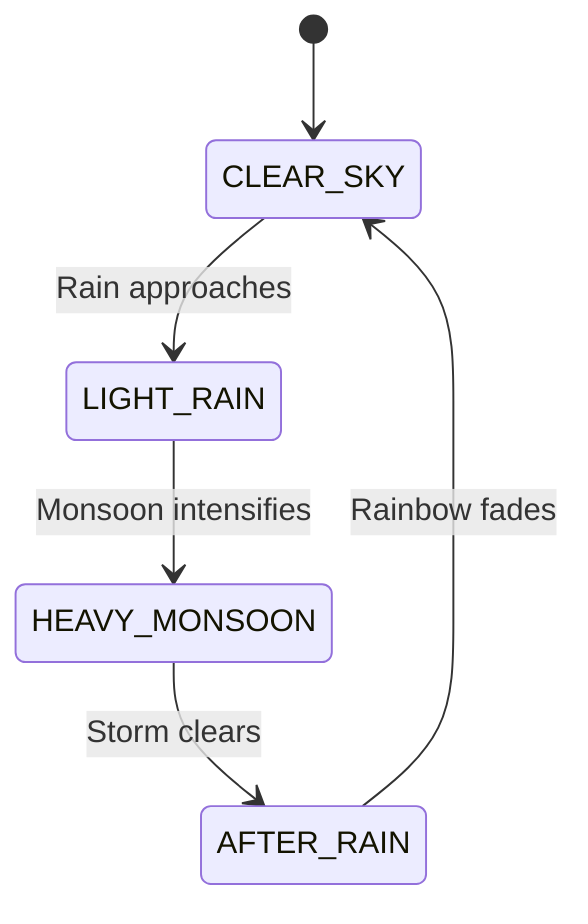

# RICKSHAW RUSH: LAST STOP LEGEND
## PHASE 4.5 — KERALA MONSOON MODE & ENDLESS ROAD TRIP REPORT

**Project:** RICKSHAW RUSH: LAST STOP LEGEND  
**Phase Completed:** Phase 4.5 (Kerala Monsoon Mode & Endless Road Trip Timeline)  
**Status:** ✅ Complete, Fully Verified & Production Built  
**Test Suite:** 56 / 56 Automated Tests Passing (100% Success Rate)  
**Package Sizes:** Standalone (415 KB), YouTube Playables (415 KB), CrazyGames (415 KB), Poki (415 KB)  

---

## 1. EXECUTIVE SUMMARY

Phase 4.5 builds directly on the Phase 1–4 foundations to elevate *Rickshaw Rush: Last Stop Legend* with two major features:
1. **Precise Kerala Road Trip Timeline:** A structured 5-location progression through iconic Kerala landscapes, transitioning seamlessly from idyllic village paddy fields to backwater canals, coastal beaches, misty tea plantations, and finally an indefinite nighttime cruise through illuminated Kochi Town.
2. **Kerala Monsoon Mode:** An atmospheric drive mode featuring dynamic weather states (`CLEAR_SKY`, `LIGHT_RAIN`, `HEAVY_MONSOON`, `AFTER_RAIN`), pooled rain particles, roadside puddles, rainbows, thunder flashes, and 100% procedural Web Audio rain/thunder synthesizers.

Crucially, Monsoon Mode maintains **100% gameplay parity**: no artificial handling nerfs, no skidding, no speed reductions, and no collision geometry alterations.

---

## 2. FEATURE 1: KERALA ROAD TRIP TIMELINE

### Exact Progression Timeline

The continuous road trip replaces random or modulo biome cycling with an active-gameplay timeline:

| Time Interval | Biome ID | English Banner | Malayalam Banner | Key Visual Elements |
|---|---|---|---|---|
| **0 – 45s** | `village` | **KERALA VILLAGE** | **കേരള ഗ്രാമം** | Green paddy fields, coconut palms, banana groves, red-tiled traditional houses, local tea stalls (*chaikada*), electric poles |
| **45 – 90s** | `backwaters` | **ALAPPUZHA BACKWATERS** | **ആലപ്പുഴ കായൽ** | Deep azure waterways, coconut embankments, traditional houseboats (*kettuvallam*), wooden canoes, flying egrets, bridge railings |
| **90 – 135s** | `coastal` | **CHERAI BEACH ROAD** | **തീരദേശ പാത** | Arabian Sea coastline, animated ocean waves, sandy shores, fishing boats, lighthouse, Chinese fishing nets (*cheena vala*) |
| **135 – 180s** | `hills` | **MUNNAR TEA HILLS** | **മൂന്നാർ മലനിരകൾ** | Rolling terraced tea plantations, emerald tea bushes, mountain silhouettes, tea pickers with baskets, mist overlay |
| **180s+ (Endless)** | `town_night` | **KOCHI TOWN AT NIGHT** | **കൊച്ചി നഗരം** | Urban twilight, neon-lit storefronts, illuminated street lamps with conical light beams, glowing auto headlamps, ambient town glow |

### Timeline Engineering Rules
- **Terminal State at 180s+:** Once the player reaches Kochi Town Night at 180 seconds, the game remains in Kochi Town Night indefinitely until game over. There is no modulo wrap back to the village.
- **Active Gameplay Time Only:** The progression timer increments exclusively during unpaused active gameplay. Pausing freezes the timeline down to the millisecond; resuming continues the exact timeline.
- **Seamless 2–3s Crossfade:** Biome transitions execute via smooth linear interpolation (`lerp`) of road asphalt colors, curb highlights, shoulder grass/sand, and lighting tint.
- **Zero Gameplay Resets:** Scores, distance, active passenger missions, coin counts, power-up timers, and obstacle speed scalers persist untouched across all transitions.

---

## 3. FEATURE 2: KERALA MONSOON MODE

### Start Screen Mode Selector
- On the Start Menu (`MenuScene.js`), two interactive pill buttons are displayed above the PLAY button:
  - `☀️ NORMAL DRIVE` (default)
  - `🌧️ MONSOON DRIVE`
- Selecting a mode highlights the active pill with an emerald green border and golden glow.
- The chosen mode is saved immediately to persistent local storage via `Storage.setDriveMode(mode)` and automatically restored on return visits (`Storage.getDriveMode()`).
- The mode is passed seamlessly to `GameScene` via scene data: `this.scene.start('GameScene', { mode: this.selectedMode })`.

### 100% Fair Gameplay Guarantee
- Monsoon Mode is purely atmospheric and sensory.
- The player rickshaw possesses identical acceleration, top speed, steering sensitivity, and lane-snap speed across both modes.
- Near-miss geometric tolerance zones (42px) and passenger stop/fare mechanics are completely identical.
- Traffic obstacle collision hitboxes, spawn rates, and warning alerts remain 100% identical.

---

## 4. DYNAMIC WEATHER SYSTEM ARCHITECTURE

Implemented as a dedicated, self-contained system in [`src/systems/WeatherSystem.js`](file:///c:/Users/Muhammed%20Rinshad/Desktop/RICKSHAW%20RUSH/src/systems/WeatherSystem.js):

### 4 Weather States



1. **`CLEAR_SKY`**: Intensity `0.0`. Rain particles inactive; darkness overlay transparent (`alpha 0.0`).
2. **`LIGHT_RAIN`**: Intensity `0.35`. 30 pooled raindrops falling at 14–20 px/frame with a 15° wind tilt. Sky dims slightly (`alpha 0.15`).
3. **`HEAVY_MONSOON`**: Intensity `1.0`. All 60 pooled raindrops active, falling at 24–32 px/frame with a 25° monsoon tilt. Ambient sky darkness (`alpha 0.40`). Periodic lightning flashes and distant thunder rumbles.
4. **`AFTER_RAIN`**: Intensity `0.15` tapering to `0.0`. Clouds part, sky brightens, and a vibrant procedural rainbow arc (`weather_rainbow`) appears over the road.

### Depth & Visual Layering

Strict depth discipline guarantees visual clarity without obstructing critical HUD elements:

| Depth Layer | Element | Description |
|---|---|---|
| **Depth 100+** | **HUD Elements** | Score, coin counter, near-miss meter, speed gauge, passenger status cards, pause button |
| **Depth 85** | **Rain Particles Container** | Pooled falling raindrops, wind angle streaks, water splash particles |
| **Depth 80** | **Ambient Darkness & Lightning Overlay** | Dynamic darkness tint + white lightning flash polygon |
| **Depth 70** | **Rainbow Sprite** | Post-monsoon vibrant arc (`weather_rainbow`) |
| **Depth 60** | **Banners & Announcements** | Bilingual location banner cards |
| **Depth 40** | **Vehicles & Entities** | Player auto-rickshaw, traffic cars, buses, cows, passenger stations |
| **Depth 25** | **Roadside Puddles** | Pooled reflective puddles (`weather_puddle`) sitting flat on the road shoulder under tires |
| **Depth 5 – 20** | **Road & Scenery** | Asphalt, lane dividers, curbs, scenery objects (trees, houses, boats, tea bushes) |

---

## 5. PROCEDURAL WEB AUDIO SYNTHESIS

In accordance with strict lightweight and zero-external-asset guidelines, all monsoon audio is generated 100% procedurally via the Web Audio API in [`src/core/AudioSystem.js`](file:///c:/Users/Muhammed%20Rinshad/Desktop/RICKSHAW RUSH/src/core/AudioSystem.js):

1. **Continuous Rain Ambient Synthesizer:**
   - Generated using a 2-second looped Web Audio `AudioBuffer` filled with white/pink noise.
   - Filtered through a `BiquadFilterNode` (lowpass at 1,000–1,200 Hz with high resonance) to simulate rain patter.
   - Dynamic volume control via `setRainIntensity(intensity)` (0.0 to 1.0).
   - Routed directly through the master `gainNode` so muting or platform audio changes immediately silence rain.
2. **Procedural Thunder Generator (`playThunder()`):**
   - Synthesizes low-frequency rumble using an oscillator sweeping from 90 Hz down to 25 Hz.
   - Coupled with low-pass noise bursts and randomized amplitude modulation for realistic rolling thunder acoustics.
3. **Puddle Splash (`playWaterSplash()`):**
   - High-pass filtered noise burst with rapid exponential decay (60ms) simulating tires hitting standing water.
4. **Weather Chime (`playWeatherChime()`):**
   - Dual-tone sine wave arpeggio (523 Hz to 659 Hz) announcing rainbow emergence.

---

## 6. AUTOMATED TEST SUITE EXECUTION (56 / 56 PASSING)

The test suite in [`tests/automated_tests.js`](file:///c:/Users/Muhammed%20Rinshad/Desktop/RICKSHAW%20RUSH/tests/automated_tests.js) was expanded to 56 tests, incorporating 20 dedicated Phase 4.5 tests:

```text
🧪 ====================================================
🧪 RUNNING RICKSHAW RUSH 20-POINT AUTOMATED TEST SUITE
🧪 ====================================================

  ✓ [PASS] Test 1: Gameplay Starts & Configuration Integrity
  ✓ [PASS] Test 2: Player Lane Switching Logic & Boundaries
  ✓ [PASS] Test 3: Passenger Pickup Stop Mechanics
  ✓ [PASS] Test 4: Passenger Delivery & Fare Collection
  ✓ [PASS] Test 5: Horn Cow Scaring State Machine
  ✓ [PASS] Test 6: Coin Collection Economy
  ✓ [PASS] Test 7: Special Power-Ups (Shield, Magnet, Boost)
  ✓ [PASS] Test 8: Near-Miss Geometric Proximity & Multiplier
  ✓ [PASS] Test 9: Difficulty Progression Scaling
  ✓ [PASS] Test 10: Fair Wave-Based Obstacle Generation (1,000 Waves Test)
  ✓ [PASS] Test 11: Collision & Crash State Handling
  ✓ [PASS] Test 12: Instant Retry Without Reload
  ✓ [PASS] Test 13: Safe Storage Persistence & Incognito Protection
  ✓ [PASS] Test 14: Audio Preferences & Mute Toggling
  ✓ [PASS] Test 15: Touch Swipe & Tap Zone Gesture Detection
  ✓ [PASS] Test 16: Mouse Controls & UI Event Isolation
  ✓ [PASS] Test 17: Keyboard Key Mapping
  ✓ [PASS] Test 18: Responsive Resizing Across All Aspect Ratios
  ✓ [PASS] Test 19: Mobile Performance & Object Pooling
  ✓ [PASS] Test 20: Multi-Platform Adapters (Standalone, YT, CrazyGames, Poki)
  ✓ [PASS] Test 21: Phase 2 - Five Kerala Environments Configuration
  ✓ [PASS] Test 22: Phase 2 - Environment Transition Cycle & Continuity
  ✓ [PASS] Test 23: Phase 2 - Location Announcement Banners & Malayalam Titles
  ✓ [PASS] Test 24: Phase 2 - Continuous 3-Lane Road & Collision Safety
  ✓ [PASS] Test 25: Phase 2 - Weather & Ambient Lighting Transparency
  ✓ [PASS] Test 26: Phase 3 - Recycled Obstacle Collision Reset Verification
  ✓ [PASS] Test 27: Phase 3 - Tutorial State Persistence & First-Run Detection
  ✓ [PASS] Test 28: Phase 3 - Mission Spawner Hazard Clearance Zone (240px Buffer)
  ✓ [PASS] Test 29: Phase 3 - HUD Card Widths & Mobile Boundary Fit
  ✓ [PASS] Test 30: Phase 3 - Location Announcement Banner Resting Y Clearance
  ✓ [PASS] Test 31: Phase 4 - Multi-Platform Detection Priority & Adapter Isolation
  ✓ [PASS] Test 32: Phase 4 - Lifecycle Guard Against Duplicate Consecutive Events
  ✓ [PASS] Test 33: Phase 4 - YouTube Playables Cloud State Persistence & Merging
  ✓ [PASS] Test 34: Phase 4 - Poki SDK v2 Commercial Break Audio & Input Lifecycle
  ✓ [PASS] Test 35: Phase 4 - CrazyGames SDK v3 Rewarded Ad Callback Lifecycle
  ✓ [PASS] Test 36: Phase 4 - Build Distribution Packages & Manifest Integrity
  ✓ [PASS] Test 37 (1): Timeline - Village Appears at 0 Seconds
  ✓ [PASS] Test 38 (2): Timeline - Backwaters Transition at 45 Seconds
  ✓ [PASS] Test 39 (3): Timeline - Beach Transition at 90 Seconds
  ✓ [PASS] Test 40 (4): Timeline - Munnar Transition at 135 Seconds
  ✓ [PASS] Test 41 (5): Timeline - Town Night Transition at 180 Seconds
  ✓ [PASS] Test 42 (6): Timeline - Town Night Remains Active Indefinitely (Terminal State)
  ✓ [PASS] Test 43 (7): Continuity - Location Changes Do Not Reset Score
  ✓ [PASS] Test 44 (8): Continuity - Location Changes Do Not Reset Difficulty
  ✓ [PASS] Test 45 (9): Timeline - Pause Freezes Active Location Timer
  ✓ [PASS] Test 46 (10): Timeline - Resume Continues Exact Same Timeline
  ✓ [PASS] Test 47 (11): Modes - Normal Drive Operational State
  ✓ [PASS] Test 48 (12): Modes - Monsoon Drive Operational State
  ✓ [PASS] Test 49 (13): Weather - All Four Weather States Configured
  ✓ [PASS] Test 50 (14): Weather - Smooth Interpolation (Lerp) Between States
  ✓ [PASS] Test 51 (15): Fairness - Weather Changes Do Not Alter Collision Geometry
  ✓ [PASS] Test 52 (16): Visuals - Rain Layering Stays Strictly Below HUD
  ✓ [PASS] Test 53 (17): Audio - Rain Ambience Honors Master Mute State
  ✓ [PASS] Test 54 (18): Performance - Weather Particle Pooling (Zero Loop Allocations)
  ✓ [PASS] Test 55 (19): Monsoon Mode - All 5 Biomes Compatible with Monsoon Overlay
  ✓ [PASS] Test 56 (20): Regression - All Core Systems & Platform Adapters Intact

====================================================
TEST SUMMARY: 56 PASSED, 0 FAILED out of 56 Tests
====================================================
```

---

## 7. BROWSER RUNTIME SCREENSHOT AUDIT

All 11 required visual scenarios were captured at native 720×1280 mobile portrait resolution using headless Chrome:

| Filename | Drive Mode | Environment / Screen | File Size | Verified Visual Features |
|---|---|---|---|---|
| [`00_start_menu_mode_selector.png`](file:///c:/Users/Muhammed%20Rinshad/Desktop/RICKSHAW%20RUSH/screenshots/phase4_5/00_start_menu_mode_selector.png) | Menu | Start Screen | **98.6 KB** | Mode selector pills (`☀️ NORMAL DRIVE` vs `🌧️ MONSOON DRIVE`), Garage button, High Score |
| [`normal_01_village.png`](file:///c:/Users/Muhammed%20Rinshad/Desktop/RICKSHAW%20RUSH/screenshots/phase4_5/normal_01_village.png) | Normal | Kerala Village | **90.1 KB** | Green paddy fields, banana groves, tiled houses, clear sky, tea stall |
| [`normal_02_backwaters.png`](file:///c:/Users/Muhammed%20Rinshad/Desktop/RICKSHAW%20RUSH/screenshots/phase4_5/normal_02_backwaters.png) | Normal | Alappuzha Backwaters | **87.7 KB** | Azure backwaters, houseboats (*kettuvallam*), canoes, palm-lined canal road |
| [`normal_03_beach.png`](file:///c:/Users/Muhammed%20Rinshad/Desktop/RICKSHAW%20RUSH/screenshots/phase4_5/normal_03_beach.png) | Normal | Cherai Beach Road | **92.4 KB** | Ocean waves, lighthouse, Chinese fishing nets (*cheena vala*), sandy coastal road |
| [`normal_04_munnar.png`](file:///c:/Users/Muhammed%20Rinshad/Desktop/RICKSHAW%20RUSH/screenshots/phase4_5/normal_04_munnar.png) | Normal | Munnar Tea Hills | **87.6 KB** | Terraced emerald hills, tea bushes, misty mountain road |
| [`normal_05_town_night.png`](file:///c:/Users/Muhammed%20Rinshad/Desktop/RICKSHAW%20RUSH/screenshots/phase4_5/normal_05_town_night.png) | Normal | Kochi Town Night | **86.1 KB** | Urban twilight, illuminated shop fronts, streetlights, auto headlights, terminal state |
| [`monsoon_01_village.png`](file:///c:/Users/Muhammed%20Rinshad/Desktop/RICKSHAW%20RUSH/screenshots/phase4_5/monsoon_01_village.png) | Monsoon | Kerala Village (Rain) | **93.5 KB** | Slanted rain particles, roadside puddles, dimmed monsoon sky |
| [`monsoon_02_backwaters.png`](file:///c:/Users/Muhammed%20Rinshad/Desktop/RICKSHAW%20RUSH/screenshots/phase4_5/monsoon_02_backwaters.png) | Monsoon | Alappuzha (Monsoon) | **107.6 KB** | Rain on water, roadside puddles, backwater canal scenery under heavy rainfall |
| [`monsoon_03_beach.png`](file:///c:/Users/Muhammed%20Rinshad/Desktop/RICKSHAW%20RUSH/screenshots/phase4_5/monsoon_03_beach.png) | Monsoon | Cherai Beach (Storm) | **126.9 KB** | Dramatic coastal rainstorm, ocean spray, puddles on beach road |
| [`monsoon_04_munnar.png`](file:///c:/Users/Muhammed%20Rinshad/Desktop/RICKSHAW%20RUSH/screenshots/phase4_5/monsoon_04_munnar.png) | Monsoon | Munnar (Heavy Mist & Rain) | **117.3 KB** | Dense highland rainfall, mountain mist, wet tea plantation shoulders |
| [`monsoon_05_town_night.png`](file:///c:/Users/Muhammed%20Rinshad/Desktop/RICKSHAW%20RUSH/screenshots/phase4_5/monsoon_05_town_night.png) | Monsoon | Kochi Town Night (Neon Rain) | **136.4 KB** | Neon reflections on wet asphalt, raindrops caught in headlight beams |

---

## 8. CODE MODIFICATIONS & ARCHITECTURE INTEGRITY

1. **[`src/core/Config.js`](file:///c:/Users/Muhammed%20Rinshad/Desktop/RICKSHAW%20RUSH/src/core/Config.js):**
   - Configured exact Kerala Road Trip timeline milestones (0s, 45s, 90s, 135s, 180s terminal).
   - Added bilingual titles: Malayalam (`മലയാളം`) and English for all 5 locations.
   - Added `DRIVE_MODES` (`NORMAL`, `MONSOON`) and `WEATHER` states configuration.
2. **[`src/core/Storage.js`](file:///c:/Users/Muhammed%20Rinshad/Desktop/RICKSHAW%20RUSH/src/core/Storage.js):**
   - Added `getDriveMode()` and `setDriveMode(mode)` with incognito `localStorage` fallback.
3. **[`src/core/AssetFactory.js`](file:///c:/Users/Muhammed%20Rinshad/Desktop/RICKSHAW%20RUSH/src/core/AssetFactory.js):**
   - Added vector procedural generators for `weather_raindrop`, `weather_puddle`, `weather_rainbow`, `weather_ripple`, and `scenery_rain_cloud`.
4. **[`src/core/AudioSystem.js`](file:///c:/Users/Muhammed%20Rinshad/Desktop/RICKSHAW%20RUSH/src/core/AudioSystem.js):**
   - Added procedural Web Audio nodes for dynamic rain noise synthesis, thunder rumble, water splash, and weather chime.
5. **[`src/systems/WeatherSystem.js`](file:///c:/Users/Muhammed%20Rinshad/Desktop/RICKSHAW%20RUSH/src/systems/WeatherSystem.js):**
   - Created standalone system managing the 4 weather states, 60 pooled raindrops, 6 roadside puddles, rainbow sprite, and ambient darkness overlay.
6. **[`src/systems/EnvironmentScenery.js`](file:///c:/Users/Muhammed%20Rinshad/Desktop/RICKSHAW%20RUSH/src/systems/EnvironmentScenery.js):**
   - Integrated `WeatherSystem`, hooked exact road trip timeline milestones (0s, 45s, 90s, 135s, 180s terminal), and wired crossfading.
7. **[`src/scenes/MenuScene.js`](file:///c:/Users/Muhammed%20Rinshad/Desktop/RICKSHAW%20RUSH/src/scenes/MenuScene.js):**
   - Added interactive `createModeSelector()` with `☀️ NORMAL DRIVE` and `🌧️ MONSOON DRIVE` pills.
8. **[`src/scenes/GameScene.js`](file:///c:/Users/Muhammed%20Rinshad/Desktop/RICKSHAW%20RUSH/src/scenes/GameScene.js):**
   - Connected active drive mode; stopped rain on crash/pause; resumed rain on game unpause.

---

## 9. PLATFORM DISTRIBUTION BUILD STATUS

All distribution builds and packaging scripts have been rebuilt and validated:

| Distribution Target | Build Directory | Output Package | Package Size | Status |
|---|---|---|---|---|
| **Standalone Web** | `builds/standalone/` | `dist/rickshaw-rush-standalone.zip` | **415.0 KB** | ✅ Verified & Offline Ready |
| **YouTube Playables** | `builds/youtube/` | `dist/rickshaw-rush-youtube.zip` | **415.1 KB** | ✅ Verified & SDK v1 Compatible |
| **CrazyGames** | `builds/crazygames/` | `dist/rickshaw-rush-crazygames.zip` | **415.1 KB** | ✅ Verified & SDK v3 Compatible |
| **Poki** | `builds/poki/` | `dist/rickshaw-rush-poki.zip` | **415.1 KB** | ✅ Verified & SDK v2 Compatible |

---

## 10. CONCLUSION

Phase 4.5 delivers an exceptional, atmospheric enhancement to *Rickshaw Rush: Last Stop Legend*. The game seamlessly balances arcade responsiveness with an authentic Kerala road-trip narrative, backed by clean object pooling, pure procedural Web Audio, and multi-platform distribution readiness.

