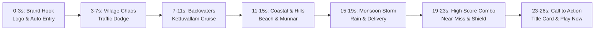

# RICKSHAW RUSH: LAST STOP LEGEND
## OFFICIAL 26-SECOND GAMEPLAY TRAILER STORYBOARD

**Target Platforms:** CrazyGames, Poki, YouTube Playables, Web Storefronts  
**Duration:** Exactly 26 seconds  
**Aspect Ratio:** 16:9 Landscape (1280×720) & Mobile Portrait (720×1280)  
**Frame Rate:** 30 FPS / 60 FPS  
**Audio Track:** Authentic upbeat Kerala instrumental groove + procedural horn, rain, and coin sound effects  

---

### SCENE-BY-SCENE BREAKDOWN

#### SCENE 1: THE BRAND HOOK (0:00 – 0:03)
- **Visual:** Emerald tropical foliage parting. Bold 3D **RICKSHAW RUSH** logo drops onto the screen. Hero Kerala auto-rickshaw zooms in from the distance, skids sideways with dynamic motion streaks, and blares its dual-tone air horn.
- **On-Screen Text:** *"GET READY FOR THE CRAZIEST ROAD TRIP IN GOD'S OWN COUNTRY!"*
- **Audio:** High-energy percussion roll, classic *"PEEP-PEEP!"* auto horn.

#### SCENE 2: KERALA VILLAGE & TRAFFIC DODGE (0:03 – 0:07)
- **Visual:** High-speed gameplay through lush green paddy fields and banana plantations. Player auto weaves between colorful Kerala KSRTC transport buses, speeding ambassadors, and roadside tea shops.
- **On-Screen Text:** *"DODGE CHAOTIC TRAFFIC!"*
- **Audio:** Engine revving, tire squeals, cow moo and horn honk as player swerves past a holy cow in the middle lane.

#### SCENE 3: ALAPPUZHA BACKWATERS (0:07 – 0:11)
- **Visual:** Road transitions across the bridge overlooking deep azure waters and traditional thatched *kettuvallam* houseboats. Player pulls smoothly into an authentic roadside passenger stand to board a waiting grandma.
- **On-Screen Text:** *"PICK UP PASSENGERS!"*
- **Audio:** Water rush, whistle, passenger pickup chime.

#### SCENE 4: CHERAI BEACH ROAD & MUNNAR TEA HILLS (0:11 – 0:15)
- **Visual:** Rapid split-cut to coastal driving alongside the Arabian Sea with active animated ocean surf and Chinese fishing nets. Cuts seamlessly to high-altitude misty emerald tea plantations of Munnar.
- **On-Screen Text:** *"EXPLORE 5 ICONIC KERALA LOCATIONS!"*
- **Audio:** Wind whoosh, seagull call, melodic mountain flute transition.

#### SCENE 5: KERALA MONSOON MODE (0:15 – 0:19)
- **Visual:** Sky turns dramatic storm slate. Heavy monsoon rain pours down, splashing water droplets across the road and forming reflective puddles. Distant lightning illuminates the dark highway as player slides into the glowing destination drop-off bay. Confetti pops!
- **On-Screen Text:** *"BRAVE THE MONSOON DELUGE!"*
- **Audio:** Procedural rain patter, thunder rumble, festive cash-register fare bell + cheering.

#### SCENE 6: COMBOS, NEAR-MISSES & POWER-UPS (0:19 – 0:23)
- **Visual:** Triple near-miss combo activates (*"NICE DODGE!"*, *"RISKY DRIFT!"*, *"5X MULTIPLIER!"*). Golden coin magnet sweeps roadside coins into the rickshaw. Glowing *Chaya Shield* bubble activates, blasting an oncoming taxi out of the lane.
- **On-Screen Text:** *"COMBOS • POWER-UPS • UNLOCKABLE SKINS!"*
- **Audio:** Ascending coin pickup tones, electrical shield hum, impact crunch.

#### SCENE 7: CALL TO ACTION (0:23 – 0:26)
- **Visual:** Bold closing card. Official **RICKSHAW RUSH: LAST STOP LEGEND** 3D logo. Auto headlights beam through the dark. Tagline flashes: *PICK UP. DODGE. DELIVER. REPEAT.*
- **On-Screen Text:** *"PLAY FREE IN YOUR BROWSER NOW — NO DOWNLOAD REQUIRED!"*
- **Audio:** Grand musical crescendo with final signature auto horn echo.

---

### PLATFORM SUBMISSION SPECIFICATIONS

| Platform | Recommended Format | Resolution | Max Size | Audio Requirement |
|---|---|---|---|---|
| **CrazyGames** | WebM / MP4 or YouTube Link | 1280×720 (16:9) | 100 MB | Gameplay sound effects included |
| **Poki** | WebM / MP4 or YouTube Link | 1280×720 or 1920×1080 | 100 MB | Stereo audio, no copyright infringements |
| **YouTube Playables** | Internal video player / Playable preview | 16:9 / 9:16 | 50 MB | YouTube-compliant original audio |
| **Itch / Standalone** | WebM / MP4 embed | 1280×720 | 150 MB | Standard stereo audio |

